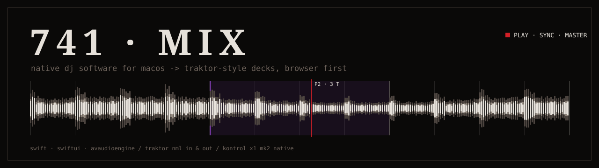
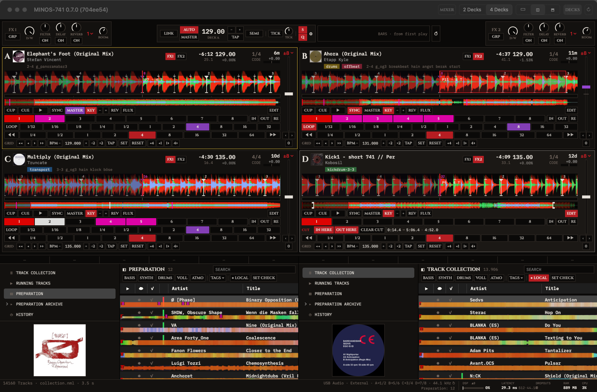

<p align="center"></p>

<p align="center"><a href="https://github.com/Slayer7411/MINOS-741/releases"></a> <a href="https://github.com/Slayer7411/MINOS-741/blob/main/CHANGELOG.md"></a> <a href="docs/MANUAL.md"></a> <a href="https://github.com/Slayer7411/MINOS-741/blob/main/LICENSE.md"></a>   </p>
<p align="center"><a href="https://github.com/Slayer7411/MINOS-741/actions/workflows/ci.yml"></a> <a href="https://github.com/Slayer7411/MINOS-741/commits/main"></a> <a href="https://github.com/Slayer7411/MINOS-741/graphs/contributors"></a> <a href="https://github.com/Slayer7411/MINOS-741/discussions"></a> <a href="https://github.com/sponsors/Slayer7411"></a></p>

```
$MINOS  v0.7.0 ▲  ·  CPU 70% -> 13% ▼  ·  PHASE 0.0000 BEATS  ·  14,160 TRACKS / 0.9 S  ·  LINK ●  ·  HID ×2
```

native dj software for macos. classic deck workflow, nml collection in and out, own browser and tag system.
built for my own setup. ideas -> [discussions](https://github.com/Slayer7411/MINOS-741/discussions), own needs -> fork it.

<p align="center"></p>

## ◆ WHAT IT DOES

* 4 decks with the classic deck set: cue / cup, 8 hotcues, auto + manual loops, beatjump, sync + master, keylock, key shift, flux, reverse, flux reverse, pitch bend
* c++ audio core, sync on its own thread -> ui can hang, sound and sync keep running
* master clock with AUTO / MASTER, tap, metronome, snap and quant, link tempo sync over the network (minos leads)
* bar counter from the first play (4 / 8 / 16 bars)
* sync modes: dynamic, fixed (keeps a shifted phase), tempo only
* gpu waveform with 3-band layers, real file level, colored beatgrid, phrase countdown, grid tools
* internal mixer or external mode -> every deck on its own usb pair
* 2 or 4 fx units, group or single mode, channel assign 1-4
* audio unit plugins (apple or third-party, v2 and v3) and VST3 effects as an effect in the fx single mode, own window per unit
* two hid controllers in native mode, incl. my custom mappings
* dual browser side by side or stacked, all library columns (move, hide, saved)
* reads the `collection.nml` of your existing library directly
* tag system on comment 2 with a configurable separator
* history, preparation and playlist export as nml
* hotcue and grid edits saved in an own file, collection untouched
* session restore after restart (decks, fx, clock, browser)
* every option has a setting (⌘,), ui in german or english

## ◆ STATUS

```
> minos --status
  core      ■ c++ realtime, lock-free, sync on its own thread
  decks     ■ 4 track decks, classic deck set
  sync      ■ master clock · link · 3 sync modes
  mixer     ■ internal + external usb mixer
  fx        ◧ 4 units, 3 effects so far
  plugins   ■ audio unit + VST3 effects in the fx single mode
  browser   ■ dual browser · all library columns · tags · smartlists
  hid       ■ native controllers, 2 units
  analysis  □ bpm / key / grid come from the collection
```

work in progress, `0.x` -> things still change. missing parts: [docs/roadmap.md](docs/roadmap.md).

## ◆ VERSIONING

* [semver](https://semver.org) tags `vX.Y.Z`, every release -> [releases](https://github.com/Slayer7411/MINOS-741/releases) + [CHANGELOG.md](CHANGELOG.md)
* app title shows version + build hash, e.g. `MINOS-741 0.7.0 (245e16c)`
* `main` = latest state, can be ahead of the last tag

## ◆ KEYS

| key | action |
|---|---|
| ⌘1-4 | focus deck a-d |
| ⌘space | play / pause |
| ⌘Y | sync |
| ⌘L | loop |
| ⌥⌘← / → | beatjump |
| ⌥⌘M | mixer on / off |
| ⌥⌘4 | 4 decks |
| ⌥⌘B | big browser |
| ⌥⌘P | reset played state |
| ⌘O | open collection |
| ⌘, | settings |

all keys can be changed under ⌘, -> KEYBOARD. full table -> [MANUAL · keys](docs/MANUAL.md#-12--keys).

## ◆ INSTALL

needs macos 15+, apple silicon or intel.

```
brew install --cask slayer7411/tap/minos-741
```

or the dmg from [releases](https://github.com/Slayer7411/MINOS-741/releases/latest). not signed by apple -> first start: system settings -> privacy & security -> OPEN ANYWAY.

## ◆ RUN IT

from source, needs xcode / swift 6.

```
git clone https://github.com/Slayer7411/MINOS-741.git
cd MINOS-741
swift run minos741
```

app bundle into /Applications:

```
scripts/make-app.sh
```

collection: the newest `collection.nml` in your library folder is found on start, others via ⌘O.
tests: `swift test`. engine self test:

```
MIX741_SELFTEST=1 MIX741_NOEXT=1 swift run minos741
```

## ◆ DOCS

```
> minos --help
```

**[→ MANUAL](docs/MANUAL.md)** -> install, decks, sync, mixer, fx, browser, tags, keys, troubleshooting, faq

* [settings](docs/settings.md) · [controllers](docs/controllers.md) · [library](docs/library.md)
* [architecture](docs/architecture.md) · [nml files](docs/nml-files.md) · [roadmap](docs/roadmap.md)
* [changelog](CHANGELOG.md) · [contributing](CONTRIBUTING.md) · [all docs](docs/README.md)

## ◆ DESIGN

ci-741:
* void / chitin black, bone white text
* red only as state (playing, sync, loop, fx on), purple for master and phrases
* cinzel in caps for labels, ibm plex mono for data
* radius 0, 1px hairlines, unicode instead of icons

fonts bundled under the sil open font license.

## ◆ CREDITS

* fonts: [cinzel](https://fonts.google.com/specimen/Cinzel), [ibm plex mono](https://fonts.google.com/specimen/IBM+Plex+Mono)
* link library, time-stretch library, VST 3 SDK: see [THIRD-PARTY-NOTICES.md](THIRD-PARTY-NOTICES.md)

not affiliated with any dj software or hardware vendor, no vendor code inside.

## ◆ CONTRIBUTING

bugs -> [issues](https://github.com/Slayer7411/MINOS-741/issues) · ideas -> [discussions](https://github.com/Slayer7411/MINOS-741/discussions) · rules, setup, release checklist -> [CONTRIBUTING.md](CONTRIBUTING.md)

## ◆ LICENSE

GPL-2.0-or-later ([LICENSE.md](LICENSE.md)), because of the link library.
* link library 3.1.5: GPL-2.0-or-later, `Sources/LinkKit`
* time-stretch / fft libraries: MIT, `Sources/MixDSP/vendor`
* VST 3 SDK 3.8.1 (hosting part): MIT, `Sources/VST3SDK` · VST is a registered trademark of Steinberg Media Technologies GmbH
* fonts: SIL open font license
* all notices and license texts: [THIRD-PARTY-NOTICES.md](THIRD-PARTY-NOTICES.md)
